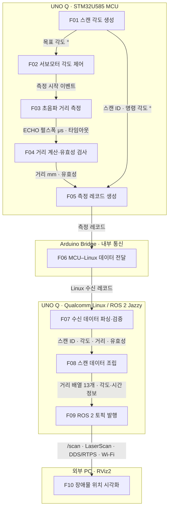

# ROS 2 기반 초음파 레이더 시스템 — 개념설계

> **상태:** 구현 전 설계안 · **개발 언어:** Arduino C++ / ROS 2 C++(`rclcpp`)

## 1. 작품 목표

Arduino UNO Q에 HC-SR04 초음파 센서 및 SG90 서보모터를 연결하여 **수평 방향의 각도별 거리**를 측정한다. STM32U585 MCU에서 신호 측정과 모터 제어를 수행하고, Arduino Bridge를 거쳐 Qualcomm Linux로 측정 레코드를 전달한다. Linux의 ROS 2 Jazzy C++ 노드는 13개 측정값을 스캔으로 조립하여 `/scan` 토픽으로 발행한다. PC에서 실행하는 RViz2가 이를 구독하여 거리와 방향을 표시한다.

## 2. 전체 기능 블록도

아래 Mermaid는 GitHub에서 수정할 수 있는 기능 블록도이다. **블록 내부는 기능명, 화살표의 문구는 출력 데이터이자 다음 블록의 입력 데이터**를 뜻한다.



## 3. 세부기능 및 입출력 데이터 정의

| ID | 기능 블록명 | 담당 | 입력 데이터 | 출력 데이터 |
|---|---|---|---|---|
| F01 | 스캔 각도 생성 | STM32 MCU | 스캔 범위(-60°~+60°), 간격(10°), 스캔 상태 | 목표 각도(°), 스캔 ID |
| F02 | 서보모터 각도 제어 | STM32 MCU·SG90 | 목표 각도(°) | PWM 신호, 측정 시작 이벤트(정착 대기 후) |
| F03 | 초음파 거리 측정 | STM32 MCU·HC-SR04 | 측정 시작 이벤트, 물체 반사파 | ECHO 펄스폭(μs), 타임아웃 여부 |
| F04 | 거리 계산·유효성 검사 | STM32 MCU | ECHO 펄스폭(μs), 타임아웃 | 거리(mm), 유효성 플래그 |
| F05 | 측정 레코드 생성 | STM32 MCU | 스캔 ID, 명령 각도(°), 거리(mm), 유효성 | 측정 레코드 |
| F06 | MCU–Linux 데이터 전달 | Arduino Bridge | 측정 레코드, 필요 시 데이터 요청 | Linux 측 측정 레코드 |
| F07 | 수신 데이터 파싱·검증 | Linux / C++ | 수신 레코드 | 검증된 스캔 ID·각도·거리·유효성 |
| F08 | 스캔 데이터 조립 | Linux / C++ | 동일 스캔 ID의 각도별 측정값 | 정렬된 거리 배열 13개, 각도·시간 정보 |
| F09 | ROS 2 토픽 발행 | Linux / `rclcpp` | 거리 배열 13개, 각도·시간 정보 | `/scan` (`sensor_msgs/msg/LaserScan`) |
| F10 | 장애물 위치 시각화 | PC / RViz2 | `/scan` 메시지 | 2D 평면상의 장애물 방향·거리 표시 |

> **중요:** F01~F10은 *기능 블록 10개*이며 ROS 2 노드가 10개라는 의미가 아니다. F07~F09는 `radar_node`라는 **하나의 C++ ROS 2 노드**로 구현할 계획이다.

## 4. 인터페이스 정의

| 구간 | 인터페이스 | 실제 전달 내용 |
|---|---|---|
| MCU → HC-SR04 | GPIO TRIG | 측정 시작 펄스 |
| HC-SR04 → MCU | GPIO ECHO | 반사파에 따른 펄스폭 |
| MCU → SG90 | PWM | 목표 회전각에 대응하는 펄스폭 |
| STM32 ↔ Qualcomm | Arduino Bridge(RPC) | 측정 레코드 / 선택적 요청 |
| ROS 2 radar_node → RViz2 | DDS/RTPS over IP, Wi-Fi 예정 | `/scan` LaserScan 메시지 |

## 5. 스캔 조건과 자료형

| 항목 | 설계값 |
|---|---|
| 스캔 범위 | 정면 기준 -60° ~ +60° |
| 측정 각도 간격 | 10° |
| 스캔당 표본 수 | 13개 |
| 구동 방식 | 편도 측정 후 시작 위치로 복귀 |
| 유효 거리 범위 | 0.02~2.00m (프로젝트 설정) |
| 메시지 | `sensor_msgs/msg/LaserScan` |
| 토픽 | `/scan` |
| 센서 프레임 | `radar_link` |

측정 레코드 예시:

```text
scan_id=42, angle_deg=-30, distance_mm=500, valid=true
```

**스캔 조립:** 동일 `scan_id`의 표본 13개를 각도 순서대로 수집하고, 거리를 m 단위로 바꾼 뒤 누락·무효 데이터를 처리한다. **메시지 발행:** 각도 범위 및 타임스탬프 등 필드를 `LaserScan`에 설정한 후 `/scan`으로 발행한다.

## 6. 설계상 한계 및 구현 전 검증 사항

- HC-SR04는 빔이 넓고 각도를 순차 측정하므로, `LaserScan` 시각화는 실제 2D LiDAR 측정의 근사 표현이다.
- SG90은 별도 위치 센서가 없으므로 측정 시작 이벤트는 실제 각도 도착 확인이 아니라 **지정한 서보 정착 시간 경과**를 뜻한다.
- Arduino Bridge의 실제 데이터 읽기/알림 방식 및 Linux의 C++ ROS 2 컨테이너 연결 방식은 구현 단계에서 검증한다.
- RViz2가 별도 PC에 있으므로 동일 네트워크에서 DDS Discovery, QoS, 방화벽 및 Docker 네트워크 설정을 확인한다.
- `LaserScan`의 스캔 시간과 시간 간격을 실제 측정 주기에 맞춰 설정한다.
- HC-SR04 ECHO 입력 전압 허용 여부, SG90 별도 5V 전원 및 공통 GND를 배선 전 확인한다.

## 7. 참고자료

- [Arduino UNO Q ROS 2 설정](https://docs.arduino.cc/tutorials/uno-q/ros2-setup/)
- [Arduino Bridge API](https://docs.arduino.cc/software/app-lab/bridge/bridge-api)
- [ROS 2 LaserScan 정의](https://docs.ros.org/en/jazzy/p/sensor_msgs/msg/LaserScan.html)
